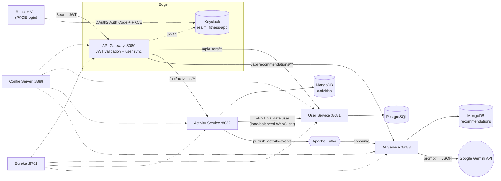

<div align="center">

# 🏋️ FitPilot

### AI-powered fitness tracker built on an event-driven Spring Boot microservices architecture

Log a workout → get a personalized AI analysis, improvement areas, next-workout suggestions and safety guidelines, generated asynchronously by **Google Gemini**.


</div>

---

## 📌 Overview

FitPilot is a full-stack, **microservices-based** fitness platform. Users sign in through Keycloak, log activities (running, cycling, walking, …) from a React UI, and receive an **AI-generated coaching report** for every workout.

The project is designed to demonstrate production-style backend engineering rather than a single CRUD app:

- **Service decomposition** with clear ownership of data (User / Activity / AI services)
- **Event-driven communication** via Kafka so that slow LLM calls never block the user
- **Centralized security** — OAuth2 / JWT validated once at an API Gateway
- **Centralized configuration** and **service discovery** with Spring Cloud Config and Eureka
- **Polyglot persistence** — PostgreSQL for relational user data, MongoDB for flexible activity & recommendation documents
- **Applied GenAI** — prompt design with a strict JSON contract, response parsing, and graceful fallback when the model output can't be parsed

---

## 🏗️ Architecture



### Request flow: logging a workout

1. The React app authenticates the user with **Keycloak** (Authorization Code + PKCE) and attaches the JWT to every API call.
2. The **Gateway** validates the JWT against Keycloak's JWKS endpoint. A custom `WebFilter` (`KeycloakUserSyncFilter`) reads the token claims, checks whether the user exists in the User Service and **auto-registers them on first login**, then forwards the request with an `X-User-ID` header.
3. The **Activity Service** verifies the user via a synchronous REST call to the User Service (Eureka-resolved, load-balanced), persists the activity to MongoDB, and **publishes it to the `activity-events` Kafka topic** (keyed by `userId`). The HTTP response returns immediately.
4. The **AI Service** consumes the event, builds a structured prompt, calls **Gemini**, parses the JSON reply into a `Recommendation` and stores it in MongoDB. If the model's output is malformed, a safe default recommendation is stored instead.
5. The UI fetches the finished recommendation from `/api/recommendations/activity/{id}`.

> **Why Kafka here?** LLM calls take seconds and can fail. Publishing an event keeps activity logging fast and reliable, lets the AI service scale and retry independently, and makes it easy to add more consumers (e.g. streaks, notifications) later.

---

## ✨ Features

| Area | What it does |
|---|---|
| 🔐 **Authentication** | Keycloak OAuth2/OIDC with PKCE on the frontend; stateless JWT resource-server security at the gateway |
| 👤 **Auto user provisioning** | First authenticated request creates the user profile from JWT claims (`sub`, `email`, `given_name`, `family_name`) |
| 🏃 **Activity tracking** | Log type, duration, calories burned, start time and free-form extra metrics (stored as a flexible map) |
| 🤖 **AI coaching** | Per-activity analysis (overall, pace, heart rate, calories), improvement areas, next-workout suggestions and safety tips |
| 📨 **Async processing** | Kafka decouples activity ingestion from AI generation |
| 🧩 **Resilient parsing** | Strips markdown fences from LLM output, extracts structured sections, falls back to a default recommendation on failure |
| 🧭 **Service discovery & config** | Eureka registry + native Spring Cloud Config Server for per-service configuration |

Supported activity types: `RUNNING`, `WALKING`, `CYCLING`, `SWIMMING`, `WEIGHT_TRAINING`, `YOGA`, `HIIT`, `CARDIO`, `STRETCHING`, `OTHER`.

---

## 🧰 Tech Stack

| Layer | Technologies |
|---|---|
| **Language / Runtime** | Java 24, Maven |
| **Backend** | Spring Boot 3.5.4, Spring Web, Spring WebFlux / WebClient, Spring Data JPA, Spring Data MongoDB, Spring Validation, Lombok |
| **Microservices** | Spring Cloud Gateway (WebFlux), Spring Cloud Config, Netflix Eureka |
| **Security** | Keycloak, OAuth2 Resource Server, JWT (Nimbus JOSE) |
| **Messaging** | Apache Kafka (`spring-kafka`, JSON serialization) |
| **Databases** | PostgreSQL (users), MongoDB (activities, recommendations) |
| **GenAI** | Google Gemini API (REST), prompt engineering with a strict JSON schema |
| **Frontend** | React 19, Vite 7, Material UI, Redux Toolkit, React Router 7, Axios, `react-oauth2-code-pkce` |

---

## 📁 Repository Structure

```
FitPilot/
├── configserver/       # Spring Cloud Config Server (native profile) — :8888
│   └── src/main/resources/config/   # per-service YAML (user, activity, ai, gateway)
├── eureka/             # Service registry — :8761
├── gateway/            # Spring Cloud Gateway, JWT security, Keycloak user-sync filter — :8080
├── userservice/        # User profiles (PostgreSQL / JPA) — :8081
├── activityservice/    # Activity CRUD (MongoDB) + Kafka producer — :8082
├── aiservice/          # Kafka consumer + Gemini integration + recommendations — :8083
└── fitness-frontend/   # React SPA (Vite) — :5173
```

---

## 🔌 API Reference

All requests go through the gateway at `http://localhost:8080` and require `Authorization: Bearer <JWT>`.

| Method | Endpoint | Description |
|---|---|---|
| `POST` | `/api/activities` | Log a new activity (publishes a Kafka event) |
| `GET` | `/api/activities` | List the current user's activities |
| `GET` | `/api/recommendations/user/{userId}` | All AI recommendations for a user |
| `GET` | `/api/recommendations/activity/{activityId}` | AI recommendation for one activity |
| `GET` | `/api/users/{userId}` | Fetch a user profile |
| `POST` | `/api/users/register` | Register a user (idempotent on email) |
| `GET` | `/api/users/{userId}/validate` | Check whether a user exists (used service-to-service) |

**Example: log an activity**

```http
POST /api/activities
Authorization: Bearer <JWT>
Content-Type: application/json

{
  "type": "RUNNING",
  "duration": 35,
  "caloriesBurned": 380,
  "startTime": "2026-01-15T06:30:00",
  "additionalMetrics": { "distanceKm": 5.2, "avgHeartRate": 156 }
}
```

**Example: AI recommendation (shape)**

```json
{
  "id": "…",
  "activityId": "…",
  "userId": "…",
  "type": "RUNNING",
  "recommendation": "Overall: …\n\nPace: …\n\nHeart Rate: …\n\nCalories: …",
  "improvements": ["Cadence: …"],
  "suggestions": ["Tempo Run: …"],
  "safety": ["Warm up for 5–10 minutes", "Stay hydrated"],
  "createdAt": "2026-01-15T07:10:42"
}
```

---

## 🚀 Getting Started

### Prerequisites

- **JDK 24** and **Maven** (each service ships with the Maven wrapper)
- **Node.js 18+** and npm
- **PostgreSQL** (default `localhost:5432`)
- **MongoDB** (default `localhost:27017`)
- **Apache Kafka** (default `localhost:9092`)
- **Keycloak** (default `localhost:8181`)
- A **Google Gemini API key** — get one at [Google AI Studio](https://aistudio.google.com/)

### 0. Clone the repository

```bash
git clone https://github.com/Yuganshhhh/FitPilot.git
cd FitPilot
```

### 1. Set up infrastructure

<details>
<summary><b>Keycloak</b></summary>

1. Start Keycloak on port **8181**.
2. Create a realm named **`fitness-app`**.
3. Create a public client **`oauth2-pkce-client`** with:
   - Standard flow enabled, PKCE (S256) required
   - Valid redirect URI: `http://localhost:5173`
   - Web origin: `http://localhost:5173`
4. Create a test user (set email, first and last name).

</details>

<details>
<summary><b>PostgreSQL</b></summary>

Create the database used by the User Service:

```sql
CREATE DATABASE "fitness-micro-user";
```

Tables are created automatically (`spring.jpa.hibernate.ddl-auto=update`).

</details>

<details>
<summary><b>MongoDB &amp; Kafka</b></summary>

Start both with default settings. Databases (`aiactivityfitness`, `airecommendationfitness`) and the `activity-events` topic are created on first use (if auto-creation is enabled on your broker, otherwise create the topic manually).

</details>

### 2. Configure

Per-service settings live in [`configserver/src/main/resources/config/`](configserver/src/main/resources/config). Review the database credentials in `user-service.yml` for your local setup.

Export the Gemini settings before starting the AI service:

```bash
export GEMINI_URL="https://generativelanguage.googleapis.com/v1beta/models/<model>:generateContent"
export GEMINI_KEY="<your-api-key>"
```

> 🔒 Never commit real keys or passwords. Use environment variables or a secrets manager for anything beyond local development.

### 3. Run the services (in this order)

```bash
# 1. Config Server  (:8888)
cd configserver && ./mvnw spring-boot:run

# 2. Eureka         (:8761)
cd eureka && ./mvnw spring-boot:run

# 3. Business services
cd userservice     && ./mvnw spring-boot:run   # :8081
cd activityservice && ./mvnw spring-boot:run   # :8082
cd aiservice       && ./mvnw spring-boot:run   # :8083  (needs GEMINI_URL / GEMINI_KEY)

# 4. API Gateway    (:8080)
cd gateway && ./mvnw spring-boot:run

# 5. Frontend       (:5173)
cd fitness-frontend && npm install && npm run dev
```

Open **http://localhost:5173**, log in with your Keycloak user, add an activity, and open it to see the AI report.

### Ports at a glance

| Component | Port |
|---|---|
| Frontend (Vite) | 5173 |
| API Gateway | 8080 |
| User Service | 8081 |
| Activity Service | 8082 |
| AI Service | 8083 |
| Config Server | 8888 |
| Eureka | 8761 |
| Keycloak | 8181 |

---

## 🧠 Engineering Highlights

- **Prompt-to-structure pipeline.** The prompt pins Gemini to an exact JSON schema; the service navigates `candidates[0].content.parts[0].text`, strips code fences, and maps `analysis`, `improvements`, `suggestions` and `safety` into a typed `Recommendation` document.
- **Failure isolation.** A Kafka publish failure doesn't fail the user's request, and an unparseable AI response degrades to a safe default instead of losing the event.
- **Idempotent onboarding.** Registration returns the existing user when the email is already known, so the gateway's first-login sync is safe to repeat.
- **Single trust boundary.** JWTs are validated once at the gateway; downstream services receive a trusted `X-User-ID` header.
- **Data ownership.** Each service owns its datastore; the Activity Service never reads user tables directly, it asks the User Service.
- **Externalized config.** Service settings are centralized in the Config Server and secrets such as the Gemini key are read from environment variables.

---

## 🗺️ Roadmap

- [ ] `docker-compose.yml` to spin up Kafka, MongoDB, PostgreSQL and Keycloak with one command
- [ ] Resilience4j circuit breaker, retry and timeout around the Gemini and User Service calls
- [ ] Kafka retry topics + dead-letter queue for failed AI generations
- [ ] Integration tests with Testcontainers (Kafka, MongoDB, PostgreSQL)
- [ ] Gateway-level check that `X-User-ID` matches the JWT `sub` claim
- [ ] Hash/omit the placeholder password and drop it from API responses (identity is owned by Keycloak)
- [ ] Polling / WebSocket updates in the UI when a recommendation becomes ready
- [ ] Spring AI migration for provider-agnostic LLM access and structured output
- [ ] Observability: Micrometer, distributed tracing, centralized logging
- [ ] CI pipeline (GitHub Actions) and containerized deployment

---

## 👨‍💻 Author

**Yugansh Sharma** — Final-year B.Tech CSE student focused on AI engineering (Java, Spring Boot, microservices) and applied GenAI.

[](https://github.com/Yuganshhhh)
[](https://linkedin.com/)
[](mailto:yugansh2511@gmail.com)

*Open to AI / backend engineering roles and internships.*

---

<div align="center">⭐ If you found this project interesting, consider giving it a star!</div>
